<a href="https://prashantx.me">
  <picture>
    <source media="(prefers-color-scheme: dark)" srcset="./assets/hero-dark.svg">
    
  </picture>
</a>

 

  I build on-chain products and trade markets with strict risk rules. 
  Started out hunting airdrops in 2021, taught myself Solidity, and now ship smart contracts, 
  dApps and AI-agent tools on Ethereum, Stellar, Base and Mantle.

  <b>OPEN TO</b> &nbsp;·&nbsp; Web3 builder roles &nbsp;·&nbsp; hackathon teams &nbsp;·&nbsp; freelance builds

 

  <a href="https://github.com/Prashant-Mishra-12569/habeas"><picture><source media="(prefers-color-scheme: dark)" srcset="./assets/card-habeas-dark.svg"></picture></a>
  <a href="https://github.com/Prashant-Mishra-12569/Orbis"><picture><source media="(prefers-color-scheme: dark)" srcset="./assets/card-orbis-dark.svg"></picture></a>
  <a href="https://github.com/Prashant-Mishra-12569/Nexis"><picture><source media="(prefers-color-scheme: dark)" srcset="./assets/card-nexis-dark.svg"></picture></a>
  <a href="https://github.com/Prashant-Mishra-12569/EstateETH"><picture><source media="(prefers-color-scheme: dark)" srcset="./assets/card-estateeth-dark.svg"></picture></a>
  <a href="https://satyavote.com/"><picture><source media="(prefers-color-scheme: dark)" srcset="./assets/card-satyavote-dark.svg"></picture></a>
  <a href="https://github.com/Prashant-Mishra-12569/DeWallet"><picture><source media="(prefers-color-scheme: dark)" srcset="./assets/card-dewallet-dark.svg"></picture></a>

  
    Try them live &nbsp;
    <a href="https://habeas-stellar.vercel.app/">Habeas</a> ·
    <a href="https://orbisagent.vercel.app/">Orbis</a> ·
    <a href="https://nexisapp.vercel.app/">Nexis</a> ·
    <a href="https://satyavote.com/">SatyaVote</a> ·
    <a href="https://dewalletcrypto.netlify.app/">DeWallet</a>
    &nbsp;&nbsp;|&nbsp;&nbsp;
    <a href="https://prashantx.me/#work">All 13 projects</a>
  

 

<picture>
  <source media="(prefers-color-scheme: dark)" srcset="./assets/stack-dark.svg">
  
</picture>

  

  <a href="https://prashantx.me"><picture><source media="(prefers-color-scheme: dark)" srcset="./assets/ticket-dark.svg"></picture></a>
  <a href="https://x.com/0xprashantt"><picture><source media="(prefers-color-scheme: dark)" srcset="./assets/mumbai-dark.svg"></picture></a>

 

<picture>
  <source media="(prefers-color-scheme: dark)" srcset="./assets/loop-dark.svg">
  
</picture>

  <a href="https://prashantx.me"><b>prashantx.me</b></a> &nbsp;·&nbsp;
  <a href="https://x.com/0xprashantt">X</a> &nbsp;·&nbsp;
  <a href="https://www.linkedin.com/in/prashant12569/">LinkedIn</a> &nbsp;·&nbsp;
  <a href="https://www.youtube.com/@PrashantOnCrypto/">YouTube</a> &nbsp;·&nbsp;
  <a href="https://dorahacks.io/hacker/prashant_dev">DoraHacks</a> &nbsp;·&nbsp;
  <a href="mailto:prashantdefi@gmail.com">Email</a> &nbsp;·&nbsp;
  <a href="https://prashantx.me/prashant-mishra-cv.pdf">CV</a>

